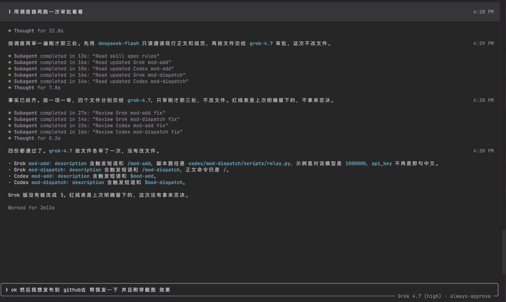

# mod-agent-skills

[](LICENSE)


面向 [Grok CLI（Grok Build）](https://docs.x.ai/build/overview) 与 [Codex](https://github.com/openai/codex) 的多模型调度技能（Agent Skills）。主会话负责拆分任务和把关，把代码通读、方案决策、修改实现和审核分别交给通过 OpenAI 兼容接口接入的第三方模型。

项目最初为一位 Minecraft 模组开发者定制，名称中的 "mod" 由此而来。技能本身与具体项目无关，可用于任意代码仓库。



## 目录

- [工作原理](#工作原理)
- [仓库结构](#仓库结构)
- [环境要求](#环境要求)
- [安装](#安装)
- [配置](#配置)
- [使用](#使用)
- [relay.py 命令参考](#relaypy-命令参考)
- [安全与数据流向](#安全与数据流向)
- [测试](#测试)
- [定制](#定制)
- [已知限制](#已知限制)
- [许可证](#许可证)

## 工作原理

### 两个技能

| 技能 | 职责 |
|---|---|
| `mod-add` | 管理中转站连接：生成本地连接文件，识别并规范 API 地址，核对可用模型。Grok 版还会把模型注册到 `~/.grok/config.toml`。 |
| `mod-dispatch` | 按角色调度第三方模型，执行"通读 → 定方案 → 修改 → 审核"流程。 |

### 角色

| 角色 | 默认模型 | 职责 |
|---|---|---|
| `read` | `deepseek-flash` | 只读通读代码，返回带文件路径和行号的事实 |
| `write` | `deepseek-v4-pro` | 按已确定的方案修改文件（Codex 版输出 unified diff） |
| `brain` | `gpt-6-luna` | 架构设计、根因分析、并发与数据一致性决策 |
| `review` | `grok-4.7` | 每项修改完成后立即审核 |

默认模型 ID 取自作者所用中转站，其他服务未必提供同名模型，配置时以服务 `/models` 实际返回的 ID 为准。

### 调度流程


1. **拆分**：主会话按文件拆分任务，保证不同子任务写入的文件互不重叠。
2. **通读**：每个文件块交给一个 `read`，只读分析并返回路径与行号。
3. **定方案**：主会话把通读结果汇总成事实清单，交给一个 `brain` 决策。方案确定后才进入修改；单文件的简单改动可跳过这一步。
4. **修改**：只实施已确定的方案，互不重叠的文件可并行交给 `write`。
5. **审核**：每完成一项修改，立即交给 `review` 审核；未通过则返工后再审。最终报告会单独列出未执行的编译、测试或运行验证。

### Grok 版与 Codex 版的差异

两版共用同一套角色和流程，接入方式不同：

| | Grok CLI | Codex |
|---|---|---|
| 调用命令 | `/mod-add`、`/mod-dispatch` | `$mod-add`、`$mod-dispatch` |
| 模型接入 | 模型注册进 `~/.grok/config.toml`，在 `/model` 中可选 | 通过 `scripts/relay.py` 直接调用 Chat Completions，不修改 Codex 配置 |
| 子代理形态 | Grok 原生子代理（`spawn_subagent` 显式指定 `model`），具备 Grok 的文件工具 | 无状态的外部请求，模型只能看到本次提交的任务和文件快照，没有 shell 和文件访问能力 |
| 文件修改 | `write` 子代理直接修改文件 | 模型返回 diff，由 Codex 核对快照哈希后应用 |
| 上下文延续 | 输出截断时用 `resume_from` 续接同一子代理 | 不保留会话，追问时需显式附上前次结论 |
| 角色映射来源 | `mod-dispatch/SKILL.md` 中的模型表 | `connection.json` 的 `models` 字段 |
| 并发与返工 | 通读按文件块全部并行 | 外部调用默认不超过 3 个并发；单项最多返工 2 轮，仍有问题交 `brain` 重新判断 |

Grok CLI 除了 `~/.grok/skills/`，也会扫描 Codex 使用的 `~/.agents/skills/`，因此可能加载到 Codex 版。为此，两版 `SKILL.md` 开头都会先识别实际运行的客户端，加载到另一版时转去执行对应版本，找不到对应版本则提示安装。

## 仓库结构

```text
mod-agent-skills/
├── mod-add/SKILL.md                # Grok CLI 版：连接配置与模型注册
├── mod-dispatch/SKILL.md           # Grok CLI 版：调度流程与角色模型表
├── codex/
│   ├── mod-add/SKILL.md            # Codex 版：连接配置
│   ├── mod-dispatch/
│   │   ├── SKILL.md                # Codex 版：调度流程
│   │   └── scripts/relay.py        # Chat Completions 调用脚本（仅依赖标准库）
│   └── tests/test_relay.py         # relay.py 单元测试
├── example/                        # 用于演练 Codex 调度的小型示例项目
├── connection.example.json         # 连接文件格式示例
└── docs/grok-dispatch.png
```

## 环境要求

- **Grok 版**：支持 Agent Skills 和子代理的 Grok CLI。
- **Codex 版**：支持 Agent Skills 的 Codex，以及 macOS 或 Linux 上的 Python 3.9+。`relay.py` 只依赖标准库。
- **中转站**：提供 OpenAI 兼容接口，至少支持 `GET /models`。Codex 版调用 `POST /chat/completions`，只支持 Responses API 的服务无法直接使用。

## 安装

两版使用同名目录，请分别安装到各自客户端的 skills 目录。同一目录下同名技能只能保留一份，混放会导致其中一版被覆盖。

### Grok CLI

```sh
git clone https://github.com/rezoch340/mod-agent-skills.git
cd mod-agent-skills

mkdir -p ~/.grok/skills
cp -R mod-add mod-dispatch ~/.grok/skills/
```

如需修改技能并让改动立即生效，可改用符号链接：

```sh
ln -s "$PWD/mod-add" ~/.grok/skills/mod-add
ln -s "$PWD/mod-dispatch" ~/.grok/skills/mod-dispatch
```

新开 Grok 会话后，斜杠菜单中会出现 `/mod-add` 和 `/mod-dispatch`。

### Codex

用户级安装：

```sh
mkdir -p ~/.agents/skills
cp -R codex/mod-add codex/mod-dispatch ~/.agents/skills/
```

也可以安装到项目内的 `.agents/skills/`。两个技能需放在同一父目录下，`mod-add` 依赖 `mod-dispatch` 中的 `relay.py`。安装后若输入 `$` 时看不到这两个技能，重启 Codex。

## 配置

### 连接文件

中转站地址、密钥和角色映射保存在 `connection.json` 中。文件位于技能包根目录，即 `mod-add` 与 `mod-dispatch` 的父目录：

| 使用方式 | 路径 |
|---|---|
| 直接在本仓库中使用 | `<仓库根目录>/connection.json`（两版共用） |
| Grok CLI 安装后 | `~/.grok/skills/connection.json` |
| Codex 用户级安装后 | `~/.agents/skills/connection.json` |
| Codex 项目级安装后 | `<项目>/.agents/skills/connection.json` |

文件格式见 [`connection.example.json`](connection.example.json)：

```json
{
  "base_url": "",
  "api_key": "",
  "models": {
    "read": "deepseek-flash",
    "write": "deepseek-v4-pro",
    "brain": "gpt-6-luna",
    "review": "grok-4.7"
  }
}
```

连接文件权限为 `0600`，已列入 `.gitignore`。早期 Grok 版的连接文件位于 `~/.grok/skills/mod-add/connection.json`，`mod-add` 会在新路径不存在时迁移其内容。

### 首次配置

推荐直接运行 `/mod-add`（Grok）或 `$mod-add`（Codex）。技能会：

1. 在上述位置生成连接文件模板，并打开所在目录供你填写；也可以直接在对话中提供地址和密钥，由代理写入。
2. 识别并规范 API 地址。`base_url` 可以是域名、API 基础路径或完整端点，例如 `relay.example`、`https://relay.example/v1/`、`https://relay.example/v1/chat/completions`。代理会补全 HTTPS、去掉末尾的 `/models`、`/chat/completions` 等端点，再请求 `/models` 确认。裸域名返回 404 时会尝试 `/v1/models`，最多核对 3 个候选地址。
3. 核对四个角色的模型 ID 是否都在服务返回的模型列表中，并列出缺失项。

401、403、429 分别按认证失败、权限不足、限流处理，不会被当作路径错误继续换地址重试。密钥只发往同一 origin（协议、主机、端口）。更换服务时，需要提供新服务的密钥，或明确要求沿用原密钥。

### Grok：注册模型

Grok 版 `mod-add` 首次运行时会询问是否把中转站上尚未加入 `/model` 的模型注册进 `~/.grok/config.toml`。注册范围包括对话模型和图像模型；ID 中含 `video` 的模型只在传入 `--video` 时注册。你的选择记录在 `~/.grok/skills/mod-add/state.json`，之后不再重复询问。

每个模型追加为一个表，只补充配置中尚不存在的 ID，不修改 `[models].default`：

```toml
[model."example-model-1.5"]
model = "example-model-1.5"
base_url = "https://relay.example/v1"
name = "Example Model 1.5"
description = "第三方模型"
api_backend = "chat_completions"
context_window = 1000000
api_key = "<连接文件中的密钥>"
```

- 模型 ID 含 `.` 时，表名必须加引号，否则 TOML 会把它解析成嵌套表。
- 对话模型的 `context_window` 为 `1000000`，图像模型为 `32000`。
- `api_backend` 和 `base_url` 的拼接方式以当前 Grok CLI 版本的实际行为为准，最终请求地址须命中已确认的端点。

写入后，技能会运行 `grok inspect` 和 `grok models` 校验配置。`/model` 列表在会话启动时读取，新注册的模型需新开会话才能选择。

## 使用

### Grok CLI

```text
/mod-dispatch 梳理存档加载流程，定位跨版本迁移丢字段的根因并修复
```

也可以用自然语言触发，例如"用 ds 读取""问 GPT""并行改""4.7 审核"。

### Codex

```text
$mod-dispatch 梳理存档加载流程，定位跨版本迁移丢字段的根因并修复
```

Codex 负责组织上下文、调用 `relay.py`、应用补丁和运行验证，不需要切换 Codex 主模型。

## relay.py 命令参考

`relay.py` 是 Codex 版的调用层，也可以单独使用。任务通过标准输入传入，结果以 JSON 输出到标准输出；出错时以 `relay: ` 前缀将错误信息写到标准错误，退出码为 1。

```sh
RELAY="$HOME/.agents/skills/mod-dispatch/scripts/relay.py"
```

| 命令 | 说明 |
|---|---|
| `init` | 连接文件不存在时创建 `0600` 空模板；已存在时只校验并收紧权限。 |
| `configure` | 从标准输入读取 JSON，合并更新 `base_url`、`api_key`、`models`。`models` 按角色合并。修改 `base_url` 时必须在同一次更新中提供 `api_key`。 |
| `models` | 请求 `GET /models`，输出模型 ID 列表、当前角色映射和服务中不存在的角色模型。 |
| `ask` | 以指定角色发送任务和附件，返回模型结果。 |

全局参数 `--config <路径>` 用于指定连接文件，必须写在子命令之前。`models` 和 `ask` 支持 `--timeout <秒>`，默认 120。

### 配置连接

密钥通过标准输入传入，避免出现在命令行参数和 shell 历史中。运行下面的命令后粘贴 JSON，按 `Ctrl-D` 结束输入：

```sh
python3 -B "$RELAY" init
python3 -B "$RELAY" configure
# {"base_url": "https://relay.example/v1", "api_key": "sk-..."}
python3 -B "$RELAY" models
```

### 发送任务

```sh
printf '%s' '分析配置加载路径，引用具体文件与行号。' |
  python3 -B "$RELAY" ask --role read \
    --workspace /absolute/path/to/project \
    --file src/config.py --file src/main.py
```

- `--workspace` 必须是已存在目录的绝对路径。
- `--file` 可重复使用，路径相对于 `--workspace`。只接受工作区内的普通 UTF-8 文本文件；指向工作区之外的符号链接会被拒绝。

成功时输出（已格式化）：

```json
{
  "role": "read",
  "model": "deepseek-flash",
  "content": "……模型返回的分析或 diff……",
  "finish_reason": "stop",
  "files": [
    {"path": "src/config.py", "sha256": "…"},
    {"path": "src/main.py", "sha256": "…"}
  ]
}
```

`files` 中的 SHA-256 对应发送时的文件快照。应用 `write` 返回的补丁前，可据此确认文件在此期间未被改动。

### 判定规则与限制

- 任务文本与附件合计不超过 1 MiB（按序列化后的请求体计算），超限直接拒绝，不截断。响应体不超过 8 MiB。
- 只有 `finish_reason` 为 `stop` 且内容非空才算成功。输出截断（`length`）、拒答、返回工具调用或响应格式异常均按失败处理。
- 不跟随 HTTP 重定向，不自动重试，不使用流式输出，不写临时文件或日志。
- `relay.py` 只返回模型输出，不执行其中的命令，也不应用其中的补丁。

## 安全与数据流向

- **数据外发**：任务描述和所选文件的内容会发送到你配置的中转站，并消耗该服务的额度。请根据代码敏感程度选择服务。
- **密钥存储**：密钥只保存在本地 `connection.json`（权限 `0600`，已列入 `.gitignore`）。`relay.py` 的错误信息不包含密钥和服务端响应内容。
- **请求边界**：密钥只发往配置的 origin，`relay.py` 拒绝重定向，因此密钥不会被转发到其他主机。
- **执行边界**：Codex 版中，第三方模型只是顾问，没有 shell 或文件访问权限；系统提示词声明附件内容是数据而非指令，补丁由 Codex 核对后应用。Grok 版中，子代理是 Grok 原生子代理，具备 Grok 授予的文件工具，权限受 Grok CLI 自身的审批设置约束。

## 测试

在仓库根目录运行。测试使用内存文件系统和 HTTP 替身，不访问网络：

```sh
python3 -B -m unittest discover -s codex/tests -v
```

测试覆盖配置合并与密钥更换约束、请求载荷、HTTP 错误与重定向处理、响应判定、附件路径与大小限制，以及各安装布局下的连接文件定位。

[`example/`](example/) 是一个小型配置加载示例，用于演练完整的 Codex 调度流程。其中的 `config_demo.py` 已由第三方模型完成修复，任务说明和作者的实测记录见 [example/README.md](example/README.md)。运行示例测试：

```sh
python3 -B -m unittest discover -s example -v
```

## 定制

- **更换角色模型**：Grok 版修改 `mod-dispatch/SKILL.md` 中的模型表；Codex 版通过 `configure` 更新 `connection.json` 的 `models` 字段。
- **调整角色提示词**：Codex 版各角色的系统提示词位于 `relay.py` 的 `ROLE_INSTRUCTIONS`。
- **调整流程**：审核轮数、并发上限等规则写在两版 `SKILL.md` 中。某条规则需要两版共享时，在一处维护，另一处引用它。
- **项目约定**：构建命令、包名和设计文档以目标项目自身的说明为准，技能运行时会读取，无需写进技能。

## 已知限制

- Codex 版只支持 Chat Completions 协议。
- Codex 版的第三方模型调用是无状态的，每次请求都要提供完整上下文。
- Codex 版不会把第三方模型注册到 Codex 的 `/model`，也不会作为 Codex 内置子代理运行。
- `relay.py` 依赖 POSIX 文件接口（如 `O_NOFOLLOW`），不支持 Windows。
- 模型列表请求成功只说明认证和模型 ID 可用，不代表推理调用或工具能力已验证。实际调用会消耗额度，技能只在你明确要求时发起测试请求。

## 许可证

[MIT](LICENSE)
